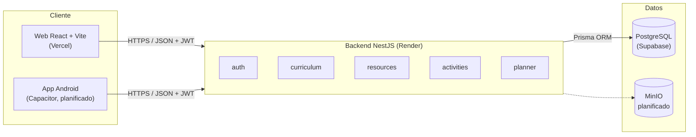

# Software Educativo

Plataforma web y móvil que ayuda a docentes de establecimientos chilenos a **planificar y preparar sus clases alineadas al currículum nacional del MINEDUC** (1° básico a 4° medio), aprovechando las pantallas interactivas que ya existen en las salas de clases.

> Proyecto APT – Asignatura CAPSTONE · Ingeniería en Informática · Duoc UC · 2026

## Aplicación en línea

| | Dirección |
|---|---|
| **Aplicación web** | https://software-educativo-azure.vercel.app |
| **API (backend)** | https://software-educativo-api.onrender.com/api |

> El backend usa el plan gratuito de Render, que suspende el servicio tras unos minutos sin uso. La primera petición después de un periodo de inactividad puede tardar hasta un minuto.

---

## Descripción

**Qué hace:** permite buscar Objetivos de Aprendizaje (OA) por asignatura, nivel o palabra clave, explorar recursos y actividades asociados, y armar planificaciones de clase guardadas en la cuenta del docente.

**A quién va dirigido:** docentes de enseñanza básica y media, y a los establecimientos que adquieren pantallas interactivas (muchas veces por licitación) y no cuentan con contenido curricular preparado para usarlas.

**Qué problema resuelve:** los colegios invierten en equipamiento tecnológico, pero el docente sigue preparando material a mano y buscando el currículum en distintas fuentes. La plataforma reúne en un solo lugar el currículum oficial, los recursos y la planificación, listos para proyectar en clase.

**Modelo de negocio:** freemium institucional (planes Gratuito, Docente Pro e Institucional), con un canal de alianza con distribuidores de pantallas interactivas. No se implementan pagos reales; un campo `plan` en el usuario permite restringir funcionalidades.

---

## Tecnologías utilizadas

| Capa | Tecnología |
|---|---|
| Frontend | React + Vite + TypeScript + Tailwind CSS, axios, react-router-dom |
| App móvil | Capacitor (generación de APK Android) |
| Backend | NestJS (Node.js) + TypeScript |
| Base de datos | PostgreSQL (Supabase) |
| ORM | Prisma (modelo, migraciones y seed) |
| Seguridad | Autenticación JWT, contraseñas cifradas con bcrypt, Row Level Security en Supabase |
| Despliegue | **Vercel** (frontend), **Render** (backend), **Supabase** (base de datos) |
| Contenedores | Docker + Docker Compose (alternativa de ejecución local) |
| Almacenamiento de archivos | MinIO *(planificado)* |
| Control de versiones | Git + GitHub |

---

## Arquitectura de la solución

Arquitectura en **tres capas** desplegada en la nube: cliente (web y móvil), API REST y persistencia. El backend sigue el patrón **Controller → Service → Prisma** en cada módulo.



| Componente | Responsabilidad | Plataforma | Estado |
|---|---|---|---|
| Frontend web | Interfaz del docente: inicio de sesión, explorador, recursos, actividades y planificador | Vercel | Implementado |
| `auth` | Registro e inicio de sesión, emisión de JWT | Render | Implementado |
| `curriculum` | Asignaturas y búsqueda de OA | Render | Implementado |
| `resources` | Recursos educativos | Render | Implementado (listado) |
| `activities` | Actividades por objetivo | Render | Implementado (listado) |
| `planner` | Planificaciones del docente (protegido con JWT) | Render | Implementado |
| Base de datos | Currículum, usuarios y planificaciones | Supabase | Implementado |
| App Android | Empaquetado del frontend con Capacitor | — | Planificado |
| MinIO | Almacenamiento de archivos de recursos | — | Planificado |

**Comunicación:** el frontend llama a la API por HTTPS usando la URL definida en `VITE_API_URL`. Las rutas protegidas exigen el token JWT en el encabezado `Authorization: Bearer`. El backend y la base de datos están en la misma región (Virginia, EE. UU.) para reducir la latencia entre ambos.

El detalle completo (diagramas UML, modelo de datos y decisiones técnicas) está en el documento de diseño dentro de las carpetas de evidencias.

---

## Estructura del repositorio

```
├── backend/              # API NestJS + Prisma
│   ├── prisma/           # schema.prisma, migraciones y seed
│   ├── src/              # módulos auth, curriculum, resources, activities, planner
│   ├── Dockerfile        # imagen del backend (ejecución local con Docker)
│   └── .env.example      # plantilla de variables de entorno
├── frontend/             # React + Vite + Tailwind
│   ├── src/              # components, context, pages, lib/api.ts
│   ├── vercel.json       # redirección de rutas para Vercel
│   └── .env.example      # URL de la API
├── docker-compose.yml    # PostgreSQL + backend (alternativa local)
├── Fase 1/               # Evidencias de la Fase 1 (definición del proyecto)
├── Fase 2/               # Evidencias de la Fase 2 (desarrollo)
└── README.md
```

---

## Instrucciones para ejecutar el proyecto localmente

### Requisitos previos

- Node.js 20 o superior y npm
- Git
- Una base de datos PostgreSQL: un proyecto de **Supabase** (recomendado) o **Docker Desktop** para levantarla en local

### 1. Clonar el repositorio

```bash
git clone https://github.com/alcayuqueo/proyectCAPSTON.git
cd proyectCAPSTON
```

### 2. Configurar la base de datos

Crea el archivo de entorno del backend a partir de la plantilla:

```bash
cd backend
cp .env.example .env
```

**Opción A – Supabase:** en Supabase, botón **Connect → ORM → Prisma**, copia `DATABASE_URL` (Transaction pooler, puerto 6543) y `DIRECT_URL` (Session pooler, puerto 5432) en `backend/.env`, reemplazando `[YOUR-PASSWORD]` por la contraseña del proyecto. Agrega `&connection_limit=1` al final de `DATABASE_URL`.

**Opción B – Docker:** desde la raíz del repositorio, levanta PostgreSQL en local. Los valores por defecto de `.env.example` ya apuntan a esta base de datos.

```bash
docker compose up -d db
```

### 3. Crear las tablas y cargar datos de ejemplo

```bash
cd backend
npm install
npx prisma migrate deploy
npx prisma db seed   # solo la primera vez
```

El seed carga asignaturas y objetivos de ejemplo (Matemática y Ciencias Naturales, 5° básico). Ejecutarlo una sola vez para no duplicar datos.

### 4. Levantar el backend

```bash
npm run start:dev
```

API disponible en `http://localhost:3000/api`.

### 5. Levantar el frontend (en otra terminal)

```bash
cd frontend
npm install
npm run dev
```

Aplicación disponible en `http://localhost:5173`. En local, Vite redirige `/api` hacia `localhost:3000`, por lo que no es necesario definir `VITE_API_URL`.

### Variables de entorno

**Backend (`backend/.env`):**

| Variable | Descripción |
|---|---|
| `DATABASE_URL` | Conexión que usa la aplicación (Supabase: Transaction pooler, puerto 6543) |
| `DIRECT_URL` | Conexión directa para migraciones (Supabase: Session pooler, puerto 5432) |
| `JWT_SECRET` | Clave aleatoria para firmar los tokens JWT. Generar con `node -e "console.log(require('crypto').randomBytes(32).toString('hex'))"` |
| `PORT` | Puerto del backend en local (`3000`). En Render se asigna automáticamente |

**Frontend (`frontend/.env`):**

| Variable | Descripción |
|---|---|
| `VITE_API_URL` | URL base de la API. Vacía en local; en Vercel, `https://software-educativo-api.onrender.com/api` |

> Los archivos `.env` contienen credenciales y **no se suben al repositorio** (están en `.gitignore`). Solo se versionan las plantillas `.env.example`.

### Problemas frecuentes

- **`Could not read package.json`:** el comando se ejecutó en la raíz del repositorio. Entra a `backend` o `frontend` antes de usar `npm`.
- **`npx prisma migrate deploy` se queda detenido:** falta `directUrl` en `schema.prisma` o `DIRECT_URL` en `.env`; las migraciones no funcionan a través del puerto 6543.
- **`failed to connect to the docker API`:** Docker Desktop no está abierto (solo aplica a la opción B).
- **npm bloquea scripts de instalación (npm 11):** aprobar los de `bcrypt`, `prisma`, `@prisma/client`, `@prisma/engines` y `esbuild`.

---

## Despliegue en la nube

| Servicio | Plataforma | Configuración |
|---|---|---|
| Base de datos | **Supabase** (plan gratuito, región East US) | Tablas creadas con `prisma migrate deploy`. Row Level Security activado en todas las tablas: solo el backend accede a los datos |
| Backend | **Render** (Web Service, Node, plan gratuito, región Virginia) | Root directory `backend`. Build: `npm install && npx prisma generate && npm run build`. Start: `npx prisma migrate deploy && node dist/main`. Variables: `DATABASE_URL`, `DIRECT_URL`, `JWT_SECRET` |
| Frontend | **Vercel** (plan Hobby) | Root directory `frontend`, preset Vite. Variable: `VITE_API_URL`. `vercel.json` redirige todas las rutas a `index.html` |

Render y Vercel están conectados al repositorio de GitHub: **cada `git push` a `main` vuelve a publicar automáticamente** el backend y el frontend.

### Generar el APK Android *(en desarrollo)*

```bash
cd frontend
npm run build
npx cap add android
npx cap sync
npx cap open android
```

---

## Endpoints principales de la API

| Método | Ruta | Descripción | Requiere JWT |
|---|---|---|---|
| POST | `/api/auth/register` | Registro de docente | No |
| POST | `/api/auth/login` | Inicio de sesión, retorna JWT | No |
| GET | `/api/curriculum/asignaturas` | Lista asignaturas y niveles | No |
| GET | `/api/curriculum/objetivos?q=` | Busca objetivos de aprendizaje | No |
| GET | `/api/resources` | Lista recursos | No |
| GET | `/api/activities` | Lista actividades | No |
| GET | `/api/planner` | Lista planificaciones del docente | Sí |
| POST | `/api/planner` | Crea una planificación de clase | Sí |

---

## Pruebas

**API:** 15 casos de prueba funcionales, todos aprobados.

| Módulo | Casos |
|---|---|
| Autenticación | Registro, login correcto, contraseña incorrecta (401), correo duplicado (409) |
| Currículum | Listar asignaturas, listar OA, búsqueda por palabra clave, por asignatura y sin resultados |
| Recursos y actividades | Listados |
| Planificador | Acceso sin sesión (401), crear, listar, datos inválidos (400) |

**Inicio de sesión y registro (frontend):** 12 casos de prueba de interfaz, todos aprobados: redirección sin sesión, validaciones, registro, persistencia de la sesión, cierre de sesión, credenciales inválidas, correo duplicado, token inválido y vista en celular.

**Despliegue:** flujo validado en la versión publicada (explorador curricular, inicio de sesión y planificador).

Las capturas están en `Fase 2/Evidencias Proyecto/Capturas`.

**Pendiente:** pruebas unitarias automatizadas, de integración, de rendimiento y de seguridad.

---

## Integrantes del equipo

| Nombre | Rol |
|---|---|
| Alex Cayuqueo | Desarrollador Full Stack: análisis, diseño, frontend, backend, base de datos, despliegue en la nube y documentación |

---

## Metodología de trabajo

El proyecto se gestiona con **Kanban**:

- **Tablero:** columnas *Backlog → Todo → In Progress → Done*, en GitHub Projects. [Ver tablero Kanban](https://github.com/users/alcayuqueo/projects/1)
- **Tareas semanales** con evidencia verificable, derivadas del cronograma ajustado tras la retroalimentación de la Fase 1.
- **Límite de trabajo en progreso** para mantener el foco en pocas tareas a la vez.
- **Commits pequeños y descriptivos** con prefijos convencionales (`feat`, `fix`, `chore`, `docs`), asociados a las tarjetas del tablero con `Closes #n`.

---

## Estado del proyecto

🟢 **Fase 1 – Definición del proyecto:** completada y evaluada.
🟡 **Fase 2 – Desarrollo:** en curso. Por indicación del docente, el alcance se amplió de un producto mínimo viable a un **producto completo**.

| Funcionalidad | Estado |
|---|---|
| Autenticación con JWT (API) | ✅ |
| Inicio de sesión y registro en el frontend | ✅ |
| Modelo de datos, migraciones y seed | ✅ |
| Explorador curricular | ✅ |
| Recursos y actividades | ✅ (listado) |
| Planificador de clases | 🔄 (API lista; falta crear, editar y eliminar desde la interfaz) |
| Despliegue en la nube (Vercel + Render + Supabase) | ✅ |
| Carga del currículum oficial MINEDUC completo | 🔄 |
| Modo presentación para pantalla interactiva | ⏳ |
| Roles y panel de administración del establecimiento | ⏳ |
| App Android (APK) | ⏳ |
| Almacenamiento de archivos (MinIO) | ⏳ |
| Pruebas automatizadas | ⏳ |

✅ hecho · 🔄 en progreso · ⏳ planificado
