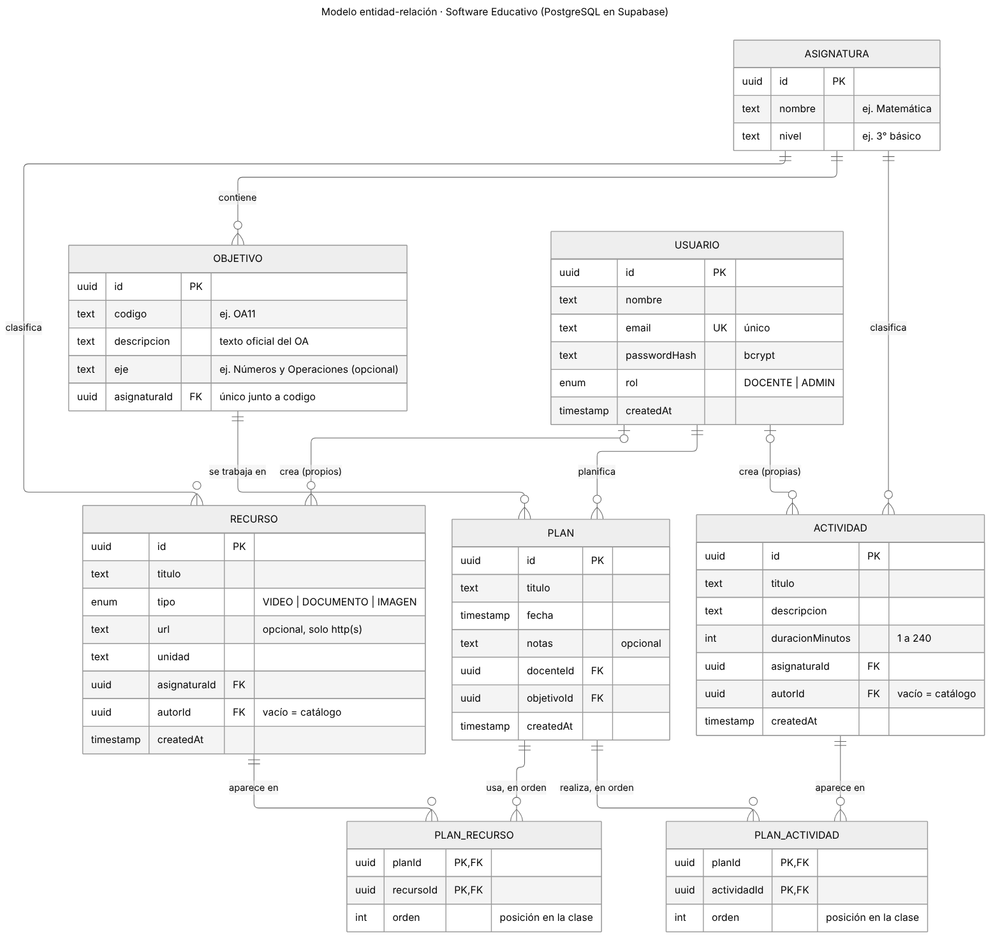
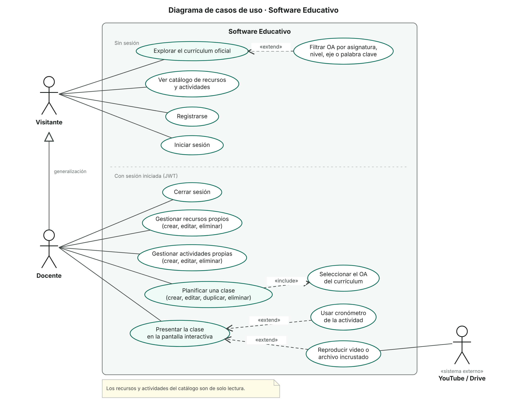
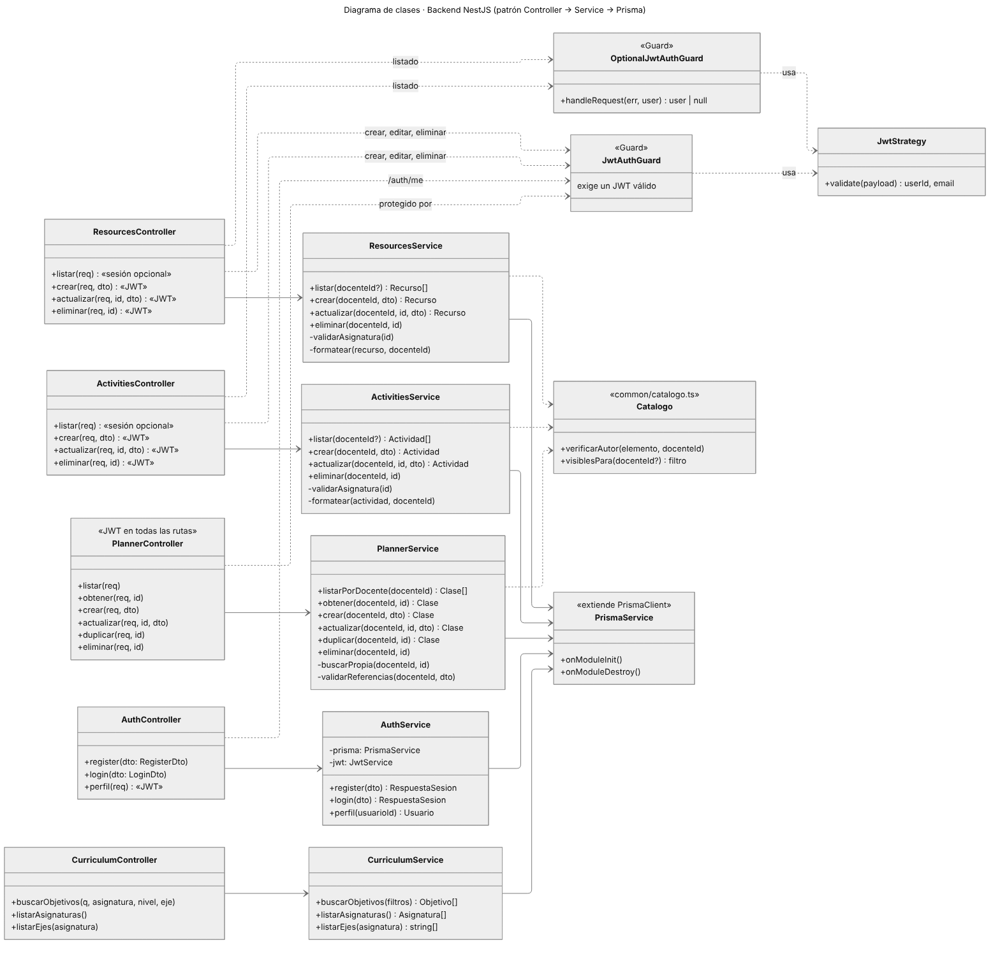
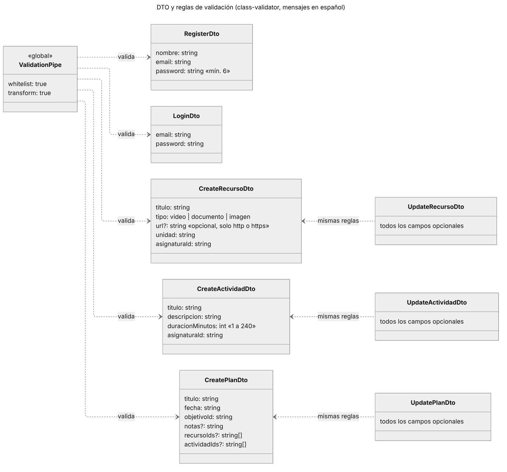
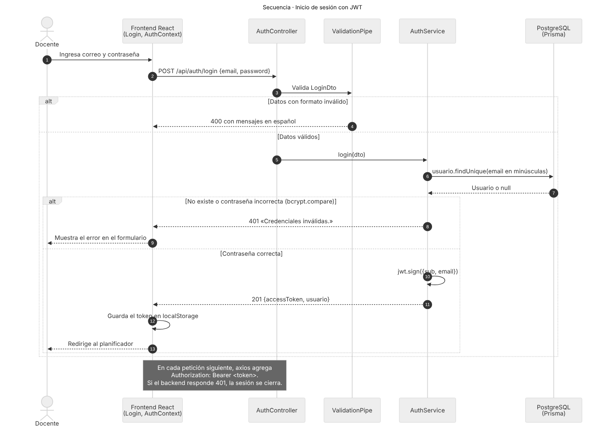
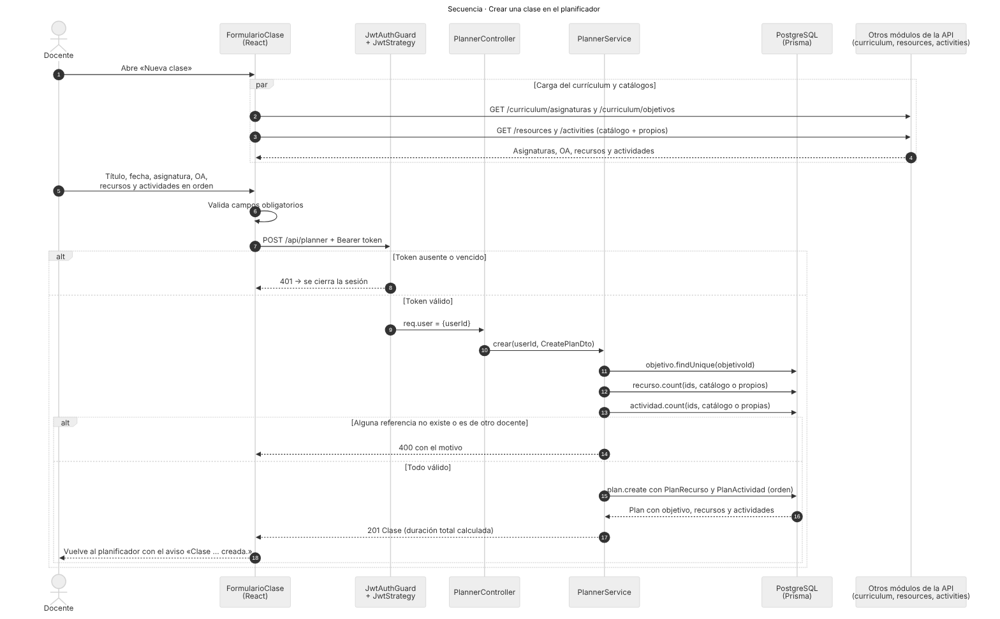
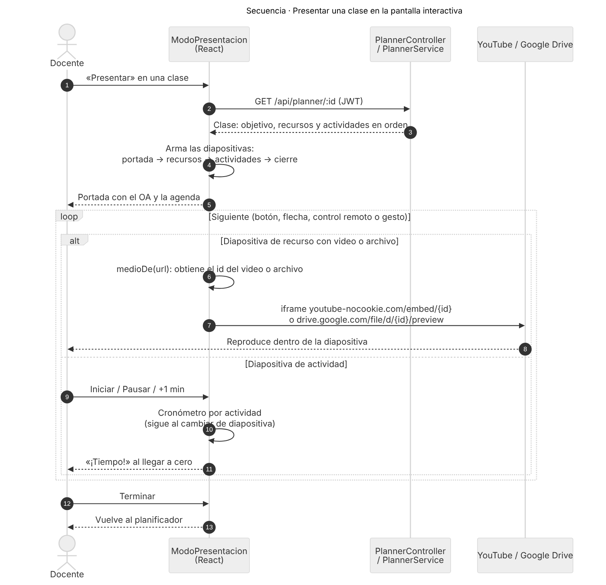
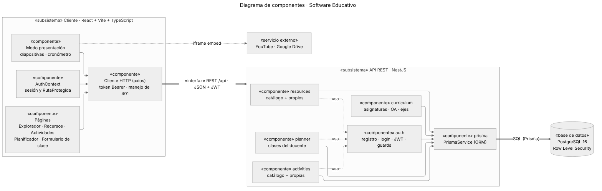
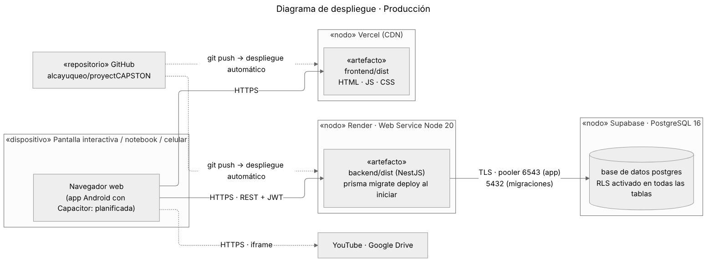

# Diagramas del proyecto

Artefactos técnicos de la Fase 2 (Instructivo CAPSTONE: *modelo de datos* y *diagramas UML mínimos: casos de uso, clases, secuencia y componentes*). Todos se armaron a partir del código del repositorio al 24 de octubre de 2026, de modo que reflejan lo que está construido y funcionando.

| N° | Diagrama | Qué muestra |
|---|---|---|
| 1 | [Modelo entidad-relación](#1-modelo-entidad-relación) | Tablas de PostgreSQL, claves y cardinalidades |
| 2 | [Casos de uso](#2-casos-de-uso) | Qué puede hacer cada actor en el sistema |
| 3 | [Clases del backend](#3-clases-del-backend) y [DTO](#3b-dto-y-validación) | Controladores, servicios, guards y reglas de validación |
| 4–6 | [Secuencia](#4-secuencia-inicio-de-sesión-con-jwt) | Inicio de sesión, crear una clase y modo presentación |
| 7 | [Componentes](#7-componentes) | Subsistemas, módulos y sus interfaces |
| 8 | [Despliegue](#8-despliegue) | Dónde se ejecuta cada parte en producción |

---

## 1. Modelo entidad-relación



- Ocho tablas, definidas en `backend/prisma/schema.prisma` y creadas con migraciones de Prisma.
- **Currículum:** cada `ASIGNATURA` (nombre y nivel) tiene sus `OBJETIVO` (OA oficiales con su eje). El código del OA es único dentro de la asignatura.
- **Catálogo y propios:** `RECURSO` y `ACTIVIDAD` tienen un `autorId` opcional. Vacío = elemento del catálogo (compartido y de solo lectura); con valor = elemento propio del docente.
- **Planificación:** cada `PLAN` (clase) pertenece a un docente y trabaja un OA. Las tablas intermedias `PLAN_RECURSO` y `PLAN_ACTIVIDAD` guardan qué recursos y actividades usa, **en orden**, que es el orden de las diapositivas del modo presentación.
- **Integridad:** al eliminar una clase se eliminan sus filas intermedias; al eliminar un recurso o actividad, la clase se conserva y solo deja de incluirlo; al eliminar una cuenta, se eliminan sus recursos y actividades propios.
- **Seguridad:** Row Level Security activado en todas las tablas de Supabase; solo el backend accede a los datos.

## 2. Casos de uso



- **Visitante** (sin sesión): explora el currículum oficial con filtros, ve el catálogo, se registra o inicia sesión.
- **Docente** (con sesión): además de lo anterior (generalización), gestiona sus recursos y actividades, planifica clases y las presenta en la pantalla interactiva.
- *Planificar una clase* **incluye** seleccionar un OA del currículum. *Presentar la clase* se **extiende** con el cronómetro de actividad y con la reproducción de videos o archivos de YouTube y Google Drive (sistema externo).

## 3. Clases del backend



Cada módulo de NestJS sigue el patrón **Controller → Service → PrismaService**. Los guards controlan el acceso: `JwtAuthGuard` exige sesión y `OptionalJwtAuthGuard` permite listados públicos que muestran más con sesión. Las funciones de `common/catalogo.ts` concentran la regla de permisos del catálogo (solo el autor modifica lo propio; el catálogo es de solo lectura).

### 3b. DTO y validación



El `ValidationPipe` global valida cada petición contra su DTO (`class-validator`), elimina campos no declarados (`whitelist`) y responde 400 con mensajes en español.

## 4. Secuencia: inicio de sesión con JWT



## 5. Secuencia: crear una clase



## 6. Secuencia: modo presentación



## 7. Componentes



## 8. Despliegue



---

## Cómo se generan

Las fuentes están en [`fuentes/`](fuentes): los diagramas 1 y 3 a 8 en **Mermaid** (`.mmd`) y el de casos de uso en un script de Python que dibuja el SVG con la notación UML (Mermaid no tiene diagramas de casos de uso). Para regenerar las imágenes:

```bash
npm install -g @mermaid-js/mermaid-cli
cd docs/diagramas
mmdc -i fuentes/01_modelo_er.mmd -o 01_modelo_er.png -c fuentes/mermaid-config.json -s 2 -b white
python fuentes/02_casos_de_uso.py 02_casos_de_uso.svg
```
